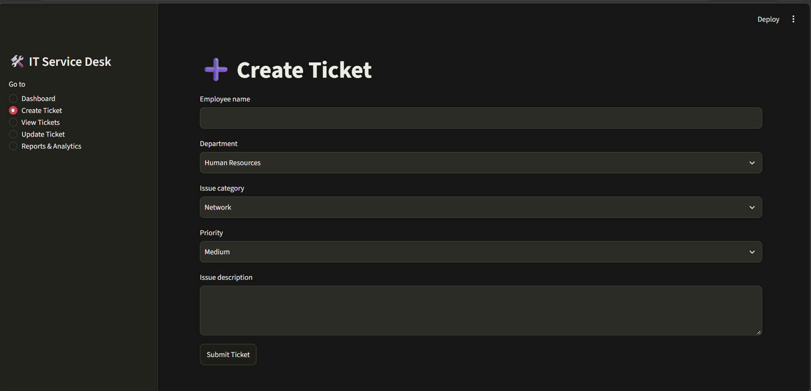
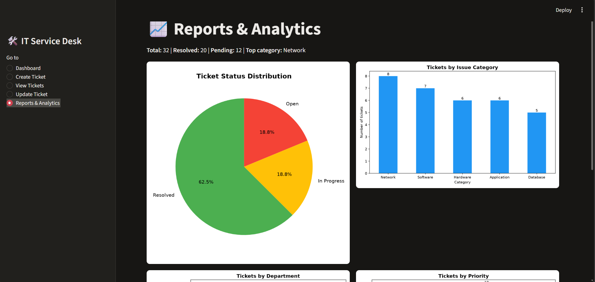

# IT Service Desk & Incident Management System

A beginner-friendly IT support ticket system built with Python, SQLite, Pandas,
Matplotlib and Streamlit. Users can raise tickets, assign technicians, track
status and view operational reports.

## Features
- Create tickets with auto-generated ID, category, priority and status
- Input validation in Python plus constraints in the database
- Search and filter by status, category, priority and keyword
- Assign technicians and update ticket status (Open -> In Progress -> Resolved)
- Delete tickets
- Pandas analysis: totals, resolved/pending, top category, department and priority distribution, average resolution time
- 4 Matplotlib charts (status, category, department, priority)
- Streamlit web app with 5 pages: Dashboard, Create Ticket, View Tickets, Update Ticket, Reports

## Tech Stack
Python, SQLite, SQL, Pandas, Matplotlib, Streamlit

## Database Design
Three tables linked by foreign keys:

- `departments` (department_id PK, department_name)
- `technicians` (technician_id PK, technician_name, specialization)
- `tickets` (ticket_id PK, employee_name, department_id FK, issue_category,
  issue_description, priority, status, created_date, resolved_date, technician_id FK)

`CHECK` constraints restrict category, priority and status to valid values.
Departments and technicians are stored once to avoid duplicate or misspelled data.

## Project Structure
```
database.py        DB connection, table creation, lookup data
sample_data.py     Loads 32 fictional sample tickets
crud.py            Create, read, search, update, delete + validation
analysis.py        Pandas analysis and report
charts.py          Matplotlib charts (saved in /charts)
app.py             Streamlit interface
sql_examples.sql   SQL query examples
```

## How to Run
```bash
python -m venv venv
venv\Scripts\activate
pip install pandas matplotlib streamlit
python database.py
python sample_data.py
python analysis.py
python charts.py
streamlit run app.py
```

## Screenshots
Add your images from the `screenshots` folder:





## What I Learned
- Designing a normalized relational schema with primary and foreign keys
- Writing SQL (CRUD, JOIN, GROUP BY) and using parameterized queries
- Separating UI from business logic
- Validating input and handling exceptions
- Analysing data with Pandas and visualizing it with Matplotlib